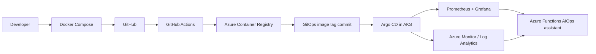

# Part 2 — Understanding the Azure Workflow

This guide follows the application from local development through Azure deployment and AIOps.

## Local development

The React frontend and six Node.js services run with PostgreSQL, Prometheus, and Grafana through
Docker Compose. Use the [local setup guide](../projects/telugu-pickles/LOCAL-SETUP.md) and run the
smoke tests before opening a pull request.

## Continuous integration

GitHub Actions run backend tests, build the frontend, and build/scan seven Linux images. When
Azure OIDC and ACR are configured, CI pushes commit-SHA tags to Azure Container Registry. It does
not apply Kubernetes manifests directly.

## GitOps delivery

CI updates `gitops/kustomization.yml`. Argo CD watches that folder in AKS and reconciles the
workloads. Regular services use Kubernetes rolling updates; Argo Rollouts controls the frontend
blue-green release and the catalog canary. See
[the progressive-delivery reference](reference/PROGRESSIVE-DELIVERY.md).

## Operations and AIOps

Prometheus and Grafana provide metrics and dashboards. AKS container logs are collected through
Azure Monitor and queried from Log Analytics. The Azure Functions AIOps assistant can also inspect
AKS resources and Prometheus metrics using a read-only managed identity. Terraform provisions its
`gpt-4o-mini` Global Standard model endpoint in South India and wires the endpoint to the Function.

## Main project paths

| Path | Role |
|---|---|
| `projects/telugu-pickles/` | Frontend, services, tests, Compose stack |
| `projects/Infrastructure/` | AzureRM Terraform bootstrap and main stacks |
| `projects/aiops-assistant/` | Azure Function API and Streamlit chat client |
| `gitops/` | AKS application and monitoring manifests |
| `.github/workflows/` | Security, Terraform, app CI, and rollout controls |
