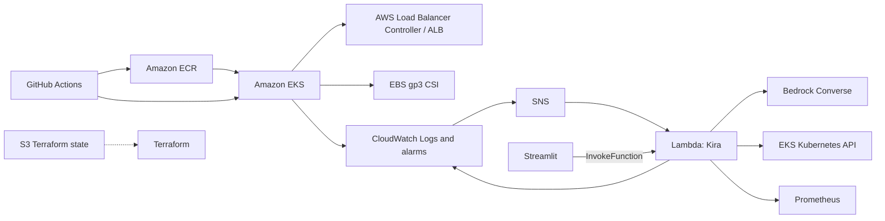
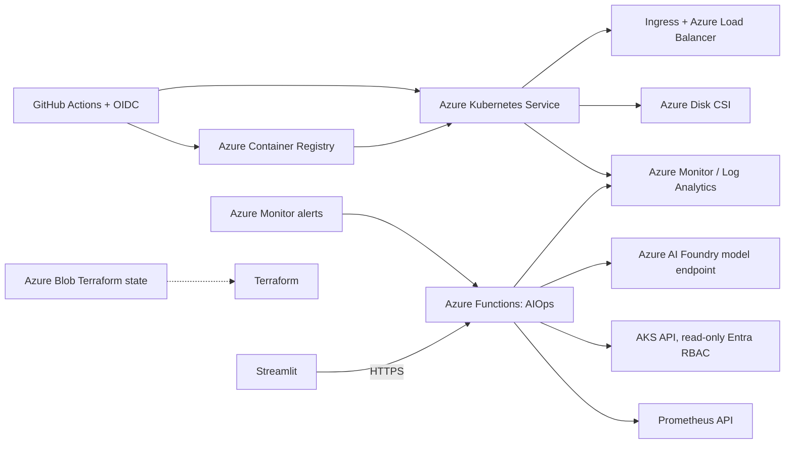

# Migration Assessment Report

## 1. Executive Summary

| Property | Value |
|----------|-------|
| **Total Functions** | 1 AWS Lambda function |
| **Source Platform** | AWS (EKS, ECR, IAM, Lambda, Bedrock, CloudWatch, SNS, S3 state) |
| **Source Runtime** | Python 3.12 for Lambda; Node.js 22 microservices |
| **Target Platform** | Azure Kubernetes Service (AKS), Azure Container Registry (ACR), Azure Functions |
| **Target Runtime** | Python 3.14 GA for Azure Functions v2; Node.js 22 containers |
| **Migration Readiness** | Medium |
| **Estimated Effort** | High |
| **Assessment Date** | 2026-11-07 |

This repository is a containerized microservices application deployed to EKS, with Terraform, Kustomize/Argo CD, Argo Rollouts, Prometheus/Grafana, and a Bedrock-powered AIOps assistant running in Lambda. AKS is the best-fit target because the project depends on Kubernetes APIs, custom Argo Rollouts resources, and a PostgreSQL StatefulSet. Azure Container Apps would require redesigning those Kubernetes-dependent parts.

The application containers are mostly cloud-neutral. The highest-effort changes are replacing AWS infrastructure and identity, converting the CI workflows and image publishing, removing AWS-specific Kubernetes storage/ingress integrations, and migrating the Lambda/Bedrock AIOps code. The source project will remain unchanged; migration output is in this sibling folder.

No Azure subscription, region, or workload sizing was supplied. Therefore, this assessment does not estimate Azure cost or deploy resources. Select an Azure region before applying the infrastructure.

## 2. Functions Inventory

| # | Function Name | Runtime | Trigger Type | Memory (MB) | Timeout (s) | Description |
|---|--------------|---------|---------------|-------------|-------------|-------------|
| 1 | `telugu-pickles-kira` | Python 3.12 | Direct Lambda invocation from Streamlit; SNS subscription for CloudWatch alarms | 512 | 300 | Multi-agent AIOps assistant using Bedrock Converse, CloudWatch Logs, Prometheus, and Kubernetes APIs |

The function is defined in `projects/Infrastructure/modules/aiops/lambda.tf`; its source is under `projects/aiops-assistant/lambda/`. Streamlit currently invokes Lambda directly and reads its configuration. The Azure UI must call an Azure Functions HTTP endpoint instead.

## 3. Service Mapping

| AWS Service | Azure Equivalent | Migration Complexity | Notes |
|-------------|------------------|----------------------|-------|
| Amazon EKS | Azure Kubernetes Service (AKS) | Medium | Preserves Kubernetes, Argo CD, Argo Rollouts, Kustomize, and workload APIs. |
| Amazon ECR | Azure Container Registry (ACR) | Low | One registry with per-service repositories; update image names and CI authentication. |
| VPC, subnets, internet gateway | Azure Virtual Network and subnets | Medium | Configure AKS networking and outbound access; do not assume AWS subnet settings transfer directly. |
| IAM roles, IRSA, EKS access entries | Microsoft Entra ID, managed identities, AKS Azure RBAC | Medium | Use GitHub OIDC and managed identities; remove AWS ARNs and policies. |
| EBS CSI / `gp3` | AKS Azure Disk CSI / `managed-csi` | Low | Stateful PostgreSQL can remain in-cluster for the demo using Azure Disk. |
| AWS Load Balancer Controller / ALB | AKS ingress controller and Azure Load Balancer | Medium | Remove ALB annotations. Rework the blue/green preview ingress and TLS/DNS integration. |
| Lambda | Azure Functions Python v2 | High | Replace Lambda event shape and deployment with HTTP-triggered function endpoints. |
| Amazon Bedrock Converse | Azure AI Foundry model deployment / Azure OpenAI-compatible endpoint | High | Port tool-call request/response handling and configure a model deployment available in the chosen region. |
| CloudWatch Logs and log metric filters | Azure Monitor / Log Analytics | Medium | Use managed identity and query AKS container logs in Log Analytics. |
| CloudWatch alarms and SNS | Azure Monitor alerts and Action Groups | Medium | Route alerts to a secured Function endpoint; use Action Group email notifications for reports. |
| S3 Terraform state | Azure Blob Storage backend | Low | Bootstrap a private, versioned storage account/container; state locking is provided by the Azure backend. |
| Route 53 and ACM | Azure DNS and managed ingress TLS / Key Vault certificates | Medium | Domain and certificate ownership/configuration must be supplied by the operator. |
| Argo CD and Argo Rollouts | Keep on AKS | Low | Existing GitOps and progressive-delivery patterns remain Kubernetes-native. |
| Self-hosted Prometheus/Grafana | Keep or adopt Azure Monitor managed metrics/Grafana | Medium | Existing Prometheus queries and dashboard can remain initially; managed services are an optional follow-up. |

## 4. Trigger & Binding Mapping

| # | Function Name | AWS Trigger | Azure Trigger | AWS Inputs/Outputs | Azure Bindings | Notes |
|---|--------------|-------------|---------------|--------------------|-----------------|-------|
| 1 | `telugu-pickles-kira` | Direct `InvokeFunction`; SNS event from CloudWatch alarm | HTTP trigger for chat/status; secured HTTP trigger for alert webhook | Chat JSON / SNS `Records`; return answer and steps / publish report | Python v2 HTTP request/response; no storage or queue binding is required for these interactions | The alert webhook must accept Azure Monitor's alert payload and validate/authenticate the caller. |

**HTTP-trigger preview (Python v2, Functions runtime v4):**

```python
import azure.functions as func

app = func.FunctionApp()

@app.route(route="aiops/ask", methods=["POST"], auth_level=func.AuthLevel.FUNCTION)
def ask(req: func.HttpRequest) -> func.HttpResponse:
    payload = req.get_json()
    result = run_investigation(payload["question"], payload.get("history", []))
    return func.HttpResponse(
        body=json.dumps(result),
        mimetype="application/json",
        status_code=200,
    )
```

The final implementation must also validate the question and distinguish model/tool failures from successful responses. A separate health route should replace the AWS `GetFunctionConfiguration` status check in the Streamlit UI.

## 5. Dependencies Analysis

| # | Package/Library | Version | AWS-Specific? | Azure Equivalent | Compatible? | Notes |
|---|----------------|---------|---------------|------------------|-------------|-------|
| 1 | `boto3` | Unpinned | Yes | `azure-identity`, `azure-monitor-query`, Azure OpenAI-compatible `openai` client | Yes, after code changes | Remove Lambda, CloudWatch, SNS, and Bedrock calls. |
| 2 | `botocore` | Unpinned/transitive | Yes | Azure SDK retry/credential policies | Yes, after code changes | Remove AWS-specific retry configuration. |
| 3 | `kubernetes` / direct Kubernetes REST client | Source-dependent | No | Keep Kubernetes API client with AKS Entra authentication | Yes, after auth changes | Restrict the Function identity to read-only AKS access. |
| 4 | `streamlit` | Unpinned | No | Keep | Yes | Replace `boto3` Lambda invocation/status checks with HTTP calls to Azure Functions. |
| 5 | `python-dotenv` | Unpinned | No | Keep for local development | Yes | Production settings should come from Function App settings/Key Vault, not a checked-in `.env`. |
| 6 | Node.js application dependencies | `package-lock.json` | No | Keep | Yes | Existing services and frontend build as containers; no cloud SDK migration identified in app runtime. |

## 6. Environment Variables & Configuration

| # | AWS Variable | Purpose | Azure Equivalent | Auth Method | Notes |
|---|-------------|---------|------------------|-------------|-------|
| 1 | `AWS_REGION` | AWS SDK region | `AZURE_LOCATION` (infrastructure only) | N/A | Azure deployment location is a user-selected value, not a direct region rename. |
| 2 | `SUPERVISOR_MODEL` | Bedrock supervisor model ID | `AZURE_OPENAI_DEPLOYMENT` | Managed identity / Entra ID | Terraform provisions `gpt-4o-mini` Global Standard in South India. |
| 3 | `SPECIALIST_MODEL` | Bedrock specialist model ID | `AZURE_OPENAI_DEPLOYMENT` or a second model setting | Managed identity / Entra ID | The current assistant uses one shared tool-calling deployment. |
| 4 | `LOG_GROUP` | CloudWatch application log group | Log Analytics workspace ID and/or configured workspace | Managed identity + Log Analytics query RBAC | Query AKS container logs in the corresponding workspace. |
| 5 | `CLUSTER_NAME`, `CLUSTER_ENDPOINT`, `CLUSTER_CA` | EKS API access | AKS resource ID / endpoint / trusted CA as needed | Function managed identity + AKS Azure RBAC | Never put an Azure client secret or long-lived Kubernetes token in app settings. |
| 6 | `REPORT_TOPIC_ARN` | SNS report topic | Azure Monitor Action Group / email receiver configuration | Azure RBAC | Replace SNS publishing; configure report delivery through Azure-native alerting. |
| 7 | `KIRA_FUNCTION` | Streamlit Lambda function name | `AIOPS_FUNCTION_URL` | Function key for local/demo, or Entra-protected API for production | Update Streamlit status and chat requests to use HTTP. |
| 8 | `PGHOST`, `PGUSER`, `PGPASSWORD`, `JWT_SECRET` | Database and token configuration | Keep names; store secrets in Azure Key Vault | AKS workload identity / Key Vault CSI or external secrets | Generate secrets outside Git and avoid Terraform outputs that expose them. |

## 7. Architecture Diagrams

### 7a. Current State (AWS)



### 7b. Target State (Azure)



## 8. IAM & Security Mapping

| AWS IAM Role/Policy | Azure RBAC Role | Scope | Notes |
|---------------------|-----------------|-------|-------|
| GitHub Actions OIDC role | Azure federated identity credential + role assignments | Resource group and ACR; AKS deployment permissions as required | Scope permissions to the repository, branch/environment, and resources; do not use subscription-wide Owner for routine CI. |
| EKS cluster/node roles | AKS system/user-assigned managed identities | AKS resource and required dependencies | AKS manages its control plane; assign only application needs. |
| IRSA for EBS CSI and controllers | AKS managed add-ons / workload identity | Specific Azure resources | Prefer supported AKS add-ons and workload identity over static credentials. |
| Kira Lambda role | Function App managed identity | Log Analytics workspace, Foundry model endpoint, AKS cluster | Use read-only AKS RBAC; no Kubernetes secret read, exec, or mutation permission. |
| Lambda basic execution policy | Azure Functions platform logging and managed identity | Function App / Application Insights | Do not embed connection secrets in source control. |
| EKS access entries / Kubernetes ClusterRole | AKS Azure RBAC for Kubernetes | AKS cluster and namespace | Preserve the current read-only AIOps access boundary. |

## 9. Monitoring & Observability Mapping

| AWS Service | Azure Equivalent | Migration Notes |
|-------------|-----------------|-----------------|
| CloudWatch Logs | Azure Monitor Logs / Log Analytics | Enable AKS monitoring and confirm application container logs are collected. |
| CloudWatch Metrics | Azure Monitor Metrics and/or Prometheus | Keep Prometheus initially for existing custom app metrics and release analysis. |
| CloudWatch Alarms | Azure Monitor metric/log alerts | Recreate the current error-count threshold and validate its evaluation window. |
| SNS alarm/report topics | Azure Monitor Action Groups | Configure webhook/email receivers and alert payload schema. |
| Lambda logs | Application Insights / Azure Monitor | Add Function telemetry and correlation IDs across chat, model, and tool calls. |
| Prometheus/Grafana | Keep Prometheus/Grafana on AKS; optionally Azure Monitor managed Prometheus/Grafana | Existing dashboards and queries should be validated against the new scrape labels and log sources. |

## 10. CI/CD & Deployment Mapping

| AWS Tool | Azure Equivalent | Notes |
|----------|------------------|-------|
| GitHub Actions + AWS OIDC role | GitHub Actions + Azure OIDC (`azure/login`) | Configure a federated credential and GitHub variables for tenant, subscription, and client IDs. No client secret should be committed. |
| ECR login/push | ACR login/push | Build and scan each image before pushing to ACR. |
| Terraform AWS provider | Terraform AzureRM provider | Replace AWS modules and remote-state bootstrap; use `azurerm` state backend in Blob Storage. |
| `aws eks update-kubeconfig` | `az aks get-credentials` | Use Entra authentication and least-privilege cluster roles. |
| Argo CD syncing `gitops/` | Keep Argo CD syncing `gitops/` on AKS | Update registry image names, AKS storage class, and ingress configuration. |
| AWS Release workflow | GitHub Actions invoking Argo Rollouts | Keep manual promotion/rollback controls; revise preview URL and health-analysis paths. |
| Lambda packaging by Terraform | Azure Functions deployment package | Build/deploy the Python Function app from its own source directory and configure app settings/identity separately. |

## 11. Project Structure Comparison

| AWS Lambda Structure | Azure Functions Structure |
|---------------------|--------------------------|
| `projects/aiops-assistant/lambda/kira.py` handler | `projects/aiops-assistant/function_app.py` with Python v2 decorators |
| `projects/aiops-assistant/lambda/*_tools.py` | Reused/adapted tool modules with Azure Monitor and AKS authentication |
| Lambda runtime / handler in Terraform | `host.json`, `requirements.txt`, and Function App settings |
| `boto3` Lambda invoke from `app.py` | HTTP client call to the Azure Functions endpoint |
| Lambda source ZIP generated by Terraform | CI-built Azure Functions package and deployment step |
| EKS/ECR/VPC Terraform modules | AzureRM AKS/ACR/network/monitoring modules |
| EKS `gp3` StorageClass and ALB annotations | AKS `managed-csi` StorageClass and Azure-compatible ingress |

## 12. Recommendations

1. **Runtime**: Use Azure Functions Python v2 programming model on Python 3.14 GA, subject to availability in the chosen Functions hosting plan and region.
2. **Hosting Plan**: Use Flex Consumption for the HTTP-driven AIOps Function; validate request duration and scale requirements because the current Lambda allows a five-minute timeout and a multi-step investigation.
3. **IaC Strategy**: Keep Terraform, replace AWS resources with AzureRM resources, and use Azure Blob remote state with versioning and RBAC.
4. **Auth Strategy**: GitHub Actions OIDC, managed identities for workloads, AKS Azure RBAC, and Key Vault for application secrets.
5. **Monitoring**: AKS monitoring with Log Analytics, Application Insights for the Function, and Prometheus/Grafana retained initially for application SLOs and rollout analysis.
6. **Database**: Use the AKS Azure Disk CSI `managed-csi` class for an architecture-preserving demo; evaluate Azure Database for PostgreSQL Flexible Server before a production deployment.
7. **Network and releases**: Replace ALB-specific annotations/controller and re-test blue/green/canary promotion, preview access, health analysis, DNS, and TLS on AKS.
8. **AI model**: Deploy a tool-calling-capable Azure AI model and migrate Bedrock Converse tool use explicitly; model IDs and regional availability are not interchangeable.
9. **Azure guidance tooling**: The requested Azure MCP best-practices/documentation tools were not available in this session. Microsoft Learn references were used for the Functions runtime, and generated infrastructure must be validated against the selected AzureRM provider and region before apply.

## 13. Next Steps

- [x] Review the existing AWS project and record this assessment before code migration.
- [x] Select AKS as the target architecture to preserve the project's Kubernetes-dependent features.
- [ ] Select an Azure subscription and region before running Terraform or deploying.
- [ ] Complete the Azure code and infrastructure migration in this output folder.
- [ ] Run tests, Terraform formatting/validation, and Kubernetes manifest checks.
- [ ] Review the converted assessment and approve deployment separately; no resources have been deployed.
